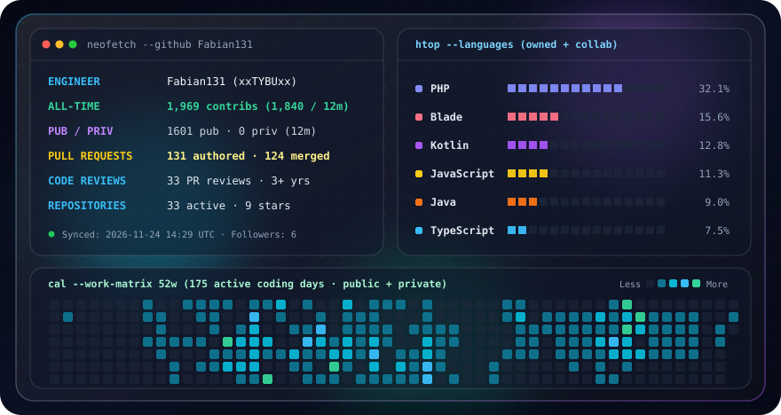
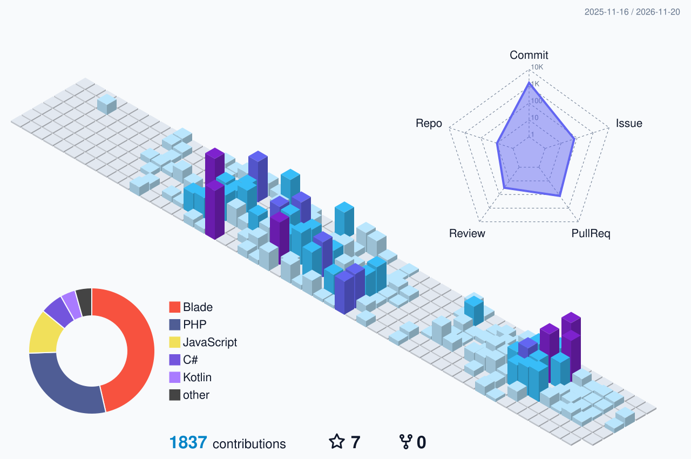
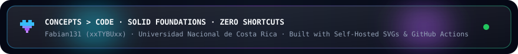

<div align="center">

<!-- Liquid Glass + Terminal + Pixel Art Hero -->


<br /><br />

<!-- Quick Connect Bar -->
<a href="https://portafolio-fabian-sanchez-salinas.netlify.app/">
  
</a>
<a href="https://www.linkedin.com/in/fabian-sanchez-salinas-270862361/">
  
</a>
<a href="mailto:fabian.sanchez.salinas@est.una.ac.cr">
  
</a>


</div>

<br />

<!-- Costa Rica & UNA Campus Sarapiquí Cultural Diorama -->
<div align="center">
  
</div>

---

### `>_` Terminal Engineering Profile & Academic Journey

```yaml
┌───────────────────────────────────────────────────────────────────────────────┐
│ fabian131@una-sarapiqui:~$ cat ./profile.yml                                  │
├───────────────────────────────────────────────────────────────────────────────┤
│ engineer      : "Fabián Sánchez Salinas (aka xxTYBUxx)"                       │
│ origin        : "Costa Rica · Región Huetar Norte y Caribe"                   │
│ university    : "Universidad Nacional (UNA) — Campus Sarapiquí"               │
│ education     :                                                               │
│   - "B.Sc. Information Systems Engineering (4th Year · 2021–Present)"         │
│   - "Diploma in Computer Applications Programming (Graduating Nov 2026)"      │
│ leadership    : "First-Year Information Systems Academic Mentor @ UNA"        │
│ specialty     : "Backend Architecture · RESTful APIs · Microservices"         │
│ frontend_split: "Web (React/Next/Blade/Tailwind) · Mobile (Kotlin/RN Expo)"   │
│ engineering   : "SOLID · DRY · Clean/Hexagonal/Service Layer/MVC/MVVM"        │
│ quality       : "126+ PRs (121 merged) · 33+ Code Reviews · English-First"    │
│ philosophy    : "CONCEPTS > CODE — solid foundations before frameworks."      │
└───────────────────────────────────────────────────────────────────────────────┘
```

---

### 📡 Live Telemetry, Pull Requests & 52-Week Work Matrix

> Auto-refreshed every **2 hours** via self-hosted GitHub Actions (`scripts/generate_stats.py`) — counting **both public & private** repositories, accurate all-time **Pull Requests**, **Code Reviews**, language breakdown, and **52-week coding activity matrix**.

<div align="center">
  
</div>

---

### 🧊 3D Isometric Contribution Landscape

<div align="center">
  
</div>

---

### ⚙️ Engineering Stack — Clear Web vs. Mobile Separation

<div align="center">

| Domain | Core Technologies &amp; Architectural Standards | Icons |
| :--- | :--- | :--- |
| **Backend &amp; APIs** | **Java** (Spring Boot), **PHP** (Laravel 12/13), **C#** (.NET 8), **Python** (FastAPI), **Go**, **Node.js** · RESTful APIs, OpenAPI/Swagger, Clean/Hexagonal, Service Layer, MVC, Microservices, WebSockets |  |
| **Frontend Web** | **React 18 / 19**, **Next.js**, **TypeScript**, **JavaScript**, **Blade**, **Alpine.js**, **Tailwind CSS 3 &amp; 4**, **Bootstrap**, **Vite 6 / 8**, **Three.js** (WebGL/Shaders), **Framer Motion**, **GSAP**, **Leaflet** · Atomic Design |  |
| **Frontend Mobile** | **Native Android:** Kotlin, Jetpack Compose, Material 3, **MVVM + Clean Architecture**, StateFlow, Hilt, Retrofit, OkHttp (JWT), Room, DataStore<br>**Cross-Platform:** React Native, Expo, Expo Router, TypeScript, Reanimated, Jest/RNTL |  |
| **Databases &amp; Geo** | **PostgreSQL + PostGIS** (GiST spatial indexes, JSONB), **MySQL 8.0**, **SQL Server**, **Redis**, **Room / SQLite** · Multi-DB per microservice isolation |  |
| **DevOps, QA &amp; Agile** | **Docker** (Multi-stage, Compose), **GitHub Actions** (CI/CD), **Prometheus + Grafana**, **AWS Lambda**, **Linux**, **PestPHP**, **Laravel Dusk E2E**, **JWT / OAuth / Spatie RBAC / Fernet** · **SCRUM** (Jira) &amp; **Kanban** (GH Projects) |  |

</div>

---

### 🏗️ Flagship Systems & Engineering Chronicle (2024 – 2026)

#### 1. 🌿 AgroVeterinaria Río Frío — Enterprise Modular Monolith <a href="https://github.com/Fabian131/AgroVeterinary-Project"><code>[Private Repo]</code></a>
> **1.5-Year Capstone Engineering Journey · Methodology: SCRUM (2-Week Sprints)**
- **Semester 1 (Discovery):** Direct client engagement, requirements elicitation, domain modeling, and use-case specification.
- **Semester 2 (Agile Foundations &amp; MVP):** Adopted agile delivery, selected the Laravel ecosystem, aligned priorities with stakeholders, and shipped **2 production modules per developer** to deliver a working **MVP**.
- **Semester 3 (Ingeniería 3 — Full SCRUM):** Executed strict **2-week Sprints** with every SCRUM ceremony (**Sprint Planning, Daily Standups, Sprint Review, and Retrospective**), delivering a hardened modular monolith with **Service Layer architecture**, comprehensive testing, and full observability.

| Layer | Technology | Implementation Details |
| :--- | :--- | :--- |
| **Frontend Web** | `Blade` + `TailwindCSS` + `Alpine.js` | Reactive UI built with reusable components and modular views |
| **Backend** | `Laravel 12` + `PHP 8.2` | **Service Layer**, Form Requests, Queued Jobs, and Mail |
| **Auth &amp; Security** | `Laravel Breeze` + `Spatie RBAC` | 4 roles, granular permissions, OTP verification, reCAPTCHA v3 |
| **Database** | `MySQL 8.0` | Versioned migrations, seeders, Eloquent ORM |
| **Assets** | `Vite 6` | Hot Module Replacement (HMR) in dev, optimized production bundles |
| **Testing** | `PestPHP` + `Laravel Dusk` | Unit, Feature (`SQLite`), and Browser E2E (`Chrome/Docker`) |
| **Infrastructure** | `Docker` + `GitHub Actions` | Multi-stage Docker builds, CI/CD pipelines, **Prometheus + Grafana** |

---

#### 2. 🚌 BusGO — Smart Public Transportation Ecosystem *(Global-Impact Project)*
> **Methodology: SCRUM using Jira · Distributed Microservices + Web Admin + Mobile Passenger**
- **Backend Microservices Monorepo** — <a href="https://github.com/AdamAG124/BusGO_Api"><code>AdamAG124/BusGO_Api</code></a> *(Private)*:
  - **API Gateway** (`:9000`), **User**, **Route**, **Payment**, **Analytics**, and **Business Bus Management** (`:8081`) services in **Java / Spring Boot**, plus a high-throughput **Location Service** (`:8085`) in **Go + Redis + WebSockets**.
  - **Isolated Database per Service** in **PostgreSQL + PostGIS** (`USER_SERVICE_DB`, `ROUTE_SERVICE_DB`, `PAYMENT_SERVICE_DB`, `ANALYTICS_SERVICE_DB`, `BUSINESS_BUS_MANAGEMENT_DB` with `BG` schema &amp; geolocated stops).
- **Frontend Web (Admin Console)** — <a href="https://github.com/diegomarln/busgo-web"><code>diegomarln/busgo-web</code></a> *(Private)*:
  - **React 18 + TypeScript + Vite + Tailwind CSS v3 + React Router** dashboard for managing bus companies, routes, stops, and real-time fleet monitoring.
- **Frontend Mobile (Passenger App)** — <a href="https://github.com/diegomarln/busgo-mobile"><code>diegomarln/busgo-mobile</code></a> *(Private)*:
  - **React Native + Expo + TypeScript** passenger application featuring real-time GPS bus tracking, contactless **QR ticket payments**, push notifications, route/fare search, trip sharing, and travel reviews.

---

#### 3. 🎲 La VuelTica — Social Gastronomic Discovery Platform
> **Methodology: Kanban (GitHub Projects) · Contract-First with OpenAPI**
- **Backend API (.NET 8 / C#)** — <a href="https://github.com/Fabian131/La-VuelTica-API"><code>Fabian131/La-VuelTica-API</code></a> *(Private)*:
  - Centralizes all business logic including the **gastronomic dice algorithm**, user profiles, and social feed.
  - Strict **MVC architecture**: `Controllers` (request entry) → `Services` (domain/business rules) → `Repositories` (data access via **Entity Framework Core**).
  - **PostgreSQL + PostGIS** (`NetTopologySuite`, `JSONB`, `GiST` spatial indexes), **JWT Bearer + BCrypt**, **FluentValidation**, **Swagger/OpenAPI**, and **Docker Compose**.
- **Frontend Mobile (Native Android)** — <a href="https://github.com/Fabian131/La-VuelTica-FrontEnd"><code>Fabian131/La-VuelTica-FrontEnd</code></a> *(Private)*:
  - Built in **Kotlin + Jetpack Compose (Material 3)** applying **MVVM + Clean Architecture** (`core/`, `data/`, `domain/`, `ui/`).
  - Unidirectional reactive state: Compose **View** observes `StateFlow` exposed by **ViewModel** → **UseCases / Repository** → **Retrofit + OkHttp** (`AuthInterceptor` attaching JWT on every request) + **Hilt DI**, **Room**, and **DataStore**.

---

#### 4. 🎟️ Event Booking — Contract-First Research Mini-Project
- **Backend API** — <a href="https://github.com/Fabian131/event-booking-api"><code>Fabian131/event-booking-api</code></a> *(Public)*: **FastAPI**, **PostgreSQL 15**, async **SQLAlchemy 2.0**, **Alembic** migrations, **JWT** (`python-jose`), **OpenAPI YAML** contracts, and **Docker**.
- **Frontend Mobile** — <a href="https://github.com/Fabian131/event-booking-mobile"><code>Fabian131/event-booking-mobile</code></a> *(Public)*: **React Native + Expo + Expo Router + TypeScript** (`(auth)`, `(admin)`, `(customer)` route groups), **Reanimated**, and automated **Jest / React Native Testing Library** CI checks.

---

#### 5. ✨ More Verified Projects, AI Research & 2024–2026 Foundations

<details open>
  <summary><code>$ cat ./full_project_catalog.md</code> — Portfolio, Rural Tourism, AI/Vision, Clinics, PHP &amp; JavaFX</summary>

<br />

| Year | Project | Stack &amp; Architecture | Repositories |
| :--- | :--- | :--- | :--- |
| **2026** | **Personal 3D Portfolio** | **Frontend Web:** React 19, Vite 8, Tailwind CSS 4, **Three.js 0.183** GPU particle shaders (`onBeforeCompile`), Framer Motion 13, GSAP 3.15, Atomic Design, ES/EN i18n, EmailJS, adaptive performance tiers. | [`Portafolio-Fabian-Sanchez`](https://github.com/Fabian131/Portafolio-Fabian-Sanchez) · [`Live Site`](https://portafolio-fabian-sanchez-salinas.netlify.app/) |
| **2026** | **Raíces — Rural Tourism Portal** | **Full-Stack Web:** Laravel 13, PHP 8.4+, Blade, Tailwind CSS 4, MySQL, Fortify auth, Leaflet (Esri World Imagery) + SNIT Costa Rica geolocation recommendations, Docker/Vercel. | [`turismo-rural-una`](https://github.com/DilanRC/turismo-rural-una) · [`Rural-Tourism-Portal`](https://github.com/Fabian131/Rural-Tourism-Portal) *(Private)* |
| **2026** | **AI Facial Recognition &amp; Access Control** | **UNA EIF-4200:** Python, `face_recognition` embeddings cache, `cryptography.Fernet` encrypted employee PII (`VARBINARY`), MySQL access audit logs, intrusion alerts. | [`IA-Sistema-de-reconocimiento-facial`](https://github.com/LuisRV5/IA-Sistema-de-reconocimiento-facial) *(Private)* |
| **2026** | **AI NLP Sentiment &amp; Sarcasm Analyzer** | **UNA EIF-4200 (Campus Sarapiquí):** Python, Transformers **BERT** (`nlptown/bert-base-multilingual-uncased-sentiment`), batch `.csv`/`.xlsx` ingestion, Spanish sarcasm &amp; negation inversion. | [`feedback-and-feelings-analysis`](https://github.com/LuisRV5/feedback-and-feelings-analysis) *(Private)* |
| **2025** | **MediCare — Private Clinic** | **Enterprise Web:** Java 21, Spring Boot 3.4.4, Spring Security, Spring Data JPA, Thymeleaf, MySQL — appointments, emergencies, ambulances, lab exams, pharmacy cart &amp; invoicing. | [`Proyecto-Clinica-Privada`](https://github.com/Fabian131/Proyecto-Clinica-Privada) *(Private)* |
| **2025** | **FastFood Ordering Platform** | **Decoupled PHP:** Separate backend API &amp; frontend web layers with `firebase/php-jwt` authentication, middleware guards, delivery fee/vehicle business logic, SQL backups. | [`paradigmass`](https://github.com/jussmoreira/paradigmass) · [`paradigmassfront`](https://github.com/jussmoreira/paradigmassfront) *(Private)* |
| **2025** | **Emergency Dispatch Client-Server** | **JavaFX Desktop:** Multi-module client-server system (`GUIControlCenter`, `LogicAPI`, `DBConnection`) connected to MySQL 8. | [`Server`](https://github.com/Fabian131/Project-2-Programming-3-Server) · [`Client`](https://github.com/Fabian131/Project-2-Programming-3-Client) *(Private)* |
| **2024–2025** | **Academic Enrollment &amp; C Systems** | Layered **JavaFX** desktop app (`domain`, `data`, `business`, `presentation`) with Jackson JSON persistence + C OS/Rummy systems programming. | [`Project-1-Programming-3`](https://github.com/Fabian131/Project-1-Programming-3) · [`Proyecto1SO`](https://github.com/jussmoreira/Proyecto1SO) *(Private)* |

</details>

---

### 👾 Retro Pixel Arcade — Commit Eater

<div align="center">
  <picture>
    <source media="(prefers-color-scheme: dark)" srcset="https://raw.githubusercontent.com/Fabian131/Fabian131/output/pacman-contribution-graph-dark.svg" />
    <source media="(prefers-color-scheme: light)" srcset="https://raw.githubusercontent.com/Fabian131/Fabian131/output/pacman-contribution-graph.svg" />
    
  </picture>
</div>

---

<div align="center">
  
</div>
